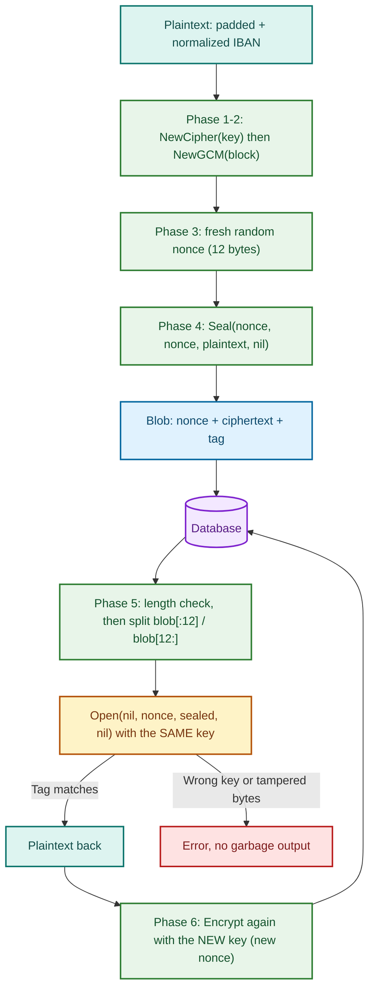

## The Problem
- The IBANs we store in the database are encrypted, and for security we want to be able to **rotate the key**: take the encrypted value from the DB, **decrypt** it, then **re-encrypt** it with a new key. The catch is that HMAC is one-way: it can tell you "yes, this is the same value" (you compute it again and compare), but you can never get the original back - it's "uncryptable". So for this job we need something **reversible**.
- **HMAC** -> One-way. Good for "is this the same thing?", useless for "give me the IBAN back".
- **AES-GCM** -> Symmetric and reversible: the same key encrypts and decrypts. The "GCM" part adds authentication: every encrypted blob carries a tag, so if someone touches the bytes (or we use the wrong key), decrypting fails with an error instead of silently handing us garbage. Plain AES modes (like CBC) only hide the data, they don't notice tampering.

## Underlying Concept / How It Works
- I will divide everything on phases, so it will be easier to follow.
- **Phase 1** -> The key becomes a cipher block (A cipher block is a method where we pass it any data along with a secret key; it slices the data into fixed-size chunks, locks each chunk by mixing it with the previous ones so no patterns remain, and lets us use that same secret key later to completely unlock and restore the original data. Simple words: We give it a key and data, it encyrpts them in a way so later you can decrypt with the same key). `aes.NewCipher(secretKey)` takes our key and gives back a raw AES block. The key length decides the flavor: 16 bytes = AES-128, 24 = AES-192, 32 = AES-256. Any other length and it returns an error. This is why we pad the IBAN before passing it through the parameter.
- **Phase 2** -> Wrap the block in GCM. A raw AES block only knows how to scramble a single 16-byte chunk, it can't safely handle a whole string on its own. `cipher.NewGCM(block)` wraps it into an AEAD (Authenticated Encryption with Associated Data), which gives us `Seal` (encrypt + sign), `Open` (verify + decrypt) and `NonceSize()` (12 bytes by default).
- **Phase 3** -> The nonce. Analogy: the key is the key to the safe, and every package we put inside also gets a fresh, one-time ticket number - that's the nonce ("number used once"). It is **not secret**, but it **must be unique** for every encryption under the same key, so we generate it with `crypto/rand` (never `math/rand`). Reusing a nonce with the same key breaks GCM completely (both secrecy and authentication). Side effect: encrypting the same IBAN twice gives two different results, because the nonce is different.
- **Phase 4** -> Seal. `aesgcm.Seal(nonce, nonce, plaintext, nil)` encrypts the data and adds a 16-byte authentication tag at the end. The first argument is `dst`: Seal **appends** its output to it. We pass the nonce there, so the result is `nonce + ciphertext + tag` in a single slice - that's the one blob we store in the DB. The last argument (additional data, `nil` here) is context that gets authenticated but not encrypted - if we ever use it, Encrypt and Decrypt must pass the exact same value.
- **Phase 5** -> Open (decrypt). The nonce isn't stored anywhere else, it sits at the front of the blob. So we strip the first `NonceSize()` bytes (the nonce), and the rest is the `sealed` part (ciphertext + tag). `gcm.Open` recomputes the tag with the key: match -> plaintext, mismatch -> error.
- **Phase 6** -> The reason we're here, key rotation: Decrypt with the old key -> plaintext in memory -> Encrypt with the new key (fresh nonce) -> store the new blob.

## Workflow / Lifecycle (Diagram)


- The layout of the blob we store:

```plaintext
blob = nonce (12 bytes) + ciphertext (same length as plaintext) + tag (16 bytes)

blob[:12]  -> nonce
blob[12:]  -> "sealed" (ciphertext + tag)
```

## Example Code and Explanation
- I'll show both functions first, then break them down. Think of it as a safe: Encrypt locks the IBAN and tapes the ticket number (nonce) to the front, Decrypt peels the ticket off first and only then opens the safe.
- **`crypto` package:**

```go
package crypto

import (
    "crypto/aes"
    "crypto/cipher"
    "crypto/rand"
    "fmt"
    "io"
)

// Documentation: https://pkg.go.dev/crypto/cipher#example-NewGCM-Encrypt
func EncryptVaultIban(secretKey []byte, paddedAndNormIBAN string) ([]byte, error) {
    block, err := aes.NewCipher(secretKey)
    if err != nil {
        return nil, err
    }

    aesgcm, err := cipher.NewGCM(block)
    if err != nil {
        return nil, err
    }

    nonce := make([]byte, aesgcm.NonceSize())
    if _, err := io.ReadFull(rand.Reader, nonce); err != nil {
        return nil, err
    }

    // dst = nonce -> the output becomes: nonce + ciphertext + tag
    return aesgcm.Seal(nonce, nonce, []byte(paddedAndNormIBAN), nil), nil
}

func Decrypt(secretkey string, ciphertext []byte) (string, error) {
    block, err := aes.NewCipher([]byte(secretkey))
    if err != nil {
        return "", err
    }

    gcm, err := cipher.NewGCM(block)
    if err != nil {
        return "", err
    }

    nonceSize := gcm.NonceSize()
    if len(ciphertext) < nonceSize {
        return "", fmt.Errorf("Given ciphertext is too short: %d", len(ciphertext))
    }

    // Since the nonce is the first part - we simply can strip it to gain it back / same for the 'sealed'
    nonce, sealed := ciphertext[:nonceSize], ciphertext[nonceSize:]
    plain, err := gcm.Open(nil, nonce, sealed, nil)
    if err != nil {
        return "", err
    }

    return string(plain), nil
}
```

- **Explanation** -> Let's go function by function.
- **`EncryptVaultIban`** -> `aes.NewCipher` and `cipher.NewGCM` are Phase 1 and 2: key -> block -> GCM. `nonce := make([]byte, aesgcm.NonceSize())` creates an empty 12-byte slice, and `io.ReadFull(rand.Reader, nonce)` fills it with random bytes from `crypto/rand`. Then the nuance that got us: **the first argument of `Seal` is `dst`, and we pass `nonce` there.** The example on pkg.go.dev passes `nil` because it keeps the nonce on the side, but we store only one blob in the DB, so we glue the nonce in front ourselves. If you pass `nil` here, the nonce is lost (it's a local variable that dies when the function returns) and `Decrypt` will never be able to open that value. One more thing: GCM does not hide the length, the output is always plaintext length + 12 (nonce) + 16 (tag).
- **`Decrypt`** -> It rebuilds the same GCM from the same key (a different key can't open it, `Open` will error). Then `len(ciphertext) < nonceSize` is a safety check: without it, `ciphertext[:nonceSize]` would panic on a blob that's too short.
- **Why we take the first part and the second part** -> Because that's exactly how `Encrypt` built the blob: `nonce + sealed`. GCM needs the **same nonce** that was used to encrypt, otherwise the tag will never match, and the nonce isn't secret, so we keep it right in front of the data. And since `NonceSize()` is a fixed number (12), we know exactly where the nonce ends and the rest begins:
- - `ciphertext[:nonceSize]` -> the **first part**: the nonce
- - `ciphertext[nonceSize:]` -> the **second part**: `sealed`, which is the encrypted data + the 16-byte tag
- **`gcm.Open(nil, nonce, sealed, nil)`** -> Recomputes the tag and compares. If it matches, we get the plaintext back. If the key is wrong or a single byte was changed, we get an error instead of garbage - that's the "authenticated" in AES-GCM.
- Finally, key rotation is just the two functions chained:

```go
plain, err := Decrypt(oldKey, blobFromDB)
if err != nil {
    return err
}

newBlob, err := EncryptVaultIban([]byte(newKey), plain) // new key, new random nonce
```

## What I Still Don't Understand
- I still can't really comprehend the full mental mode of it, but knowing the process is more than enough.

## Documentation Sources

- **[Encrypt](https://pkg.go.dev/crypto/cipher#example-NewGCM-Encrypt)**
- **[Decrypt](https://pkg.go.dev/crypto/cipher#example-NewGCM-Decrypt)**