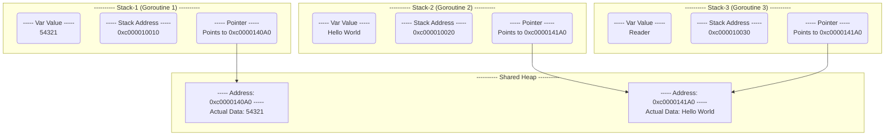

## Where I Noticed the Gap
* I noticed it when building `yashiro-miko`, I was working on the `currency.go` file inside `yaotose` - the problem was clear, I had no idea how to update the rates of the given currencies... I imediatelly fallback to Redis, because Redis is fast and it would've been unnoticeable, but calling Redis for such simple thing felt shaming.

## The Problem
* Speed wasn't a problem, since Redis per se is fast, but something different was the problem, the fragility of such process, the scenarios were this:
* * **Availability & Network Drops (Connection lost, timeout, etc...):** Any transient network blip or timeout between the application and Redis interrupts the workflow mid-flight and stops the transaction.
* * **RAM has amnesia** -> Redis is memory-first, disk-second. Even with disk backups turned on, it usually saves every second or every few minutes—not instantly. If the server crashes or loses power, anything sitting in RAM since the last save is wiped out.
* * **Full RAM** -> If workers slow down and jobs pile up, Redis hits its memory limit. Once full, it either blocks all new jobs (breaking your app) or starts deleting old keys to free up space (quietly deleting your queued work). Main reason why it's not fitting for such job. Think that you rely on a single Redis instace, the moment it fills up and you get data again, when you'll try inserting, it will simply delete older values.

## Underlying Concept / How It Works
* **Go always copies what you pass.** Whenever you send anything into a function—an `int`, a `struct`, or even a pointer—Go never hands over the original directly. Instead, it makes a copy inside that function's temporary workspace, called a **stack frame**. You can picture a normal variable (`x := 10`) as a physical box holding `10` at a specific memory **address**, like `0x104`. By default, there is no pointer attached to it—just the box sitting at its address.
* **A pointer is just a messenger holding an address.** A pointer only exists when you explicitly create one with `&x`. Writing `ptr := &x` is like hiring a guy whose only job is holding a slip of paper with `0x104` written on it. Normally, short-lived boxes live on the **stack**, which is fast and gets wiped clean as soon as the function finishes. However, if a pointer needs to outlive the function (for example, returning `&x` or saving it inside an `atomic.Pointer`), Go automatically moves that box to the **heap** so it stays alive safely in shared memory.
* **How Go compares to C and Rust.** Unlike Rust, Go does not transfer ownership when you pass a variable into a function. Go works just like C in this regard: it copies whatever you hand it and leaves the original variable alone.
* **Why pointers let functions change things without returning:**
  * **Without a pointer (`func update(b Box)`)** -> Go duplicates the whole box for the function. Changing the duplicate leaves the original box untouched.
  * **With a pointer (`func update(b *Box)`)** -> Go still copies, but it only copies the address slip (`0x104`). Both the caller and the function look at `0x104`, so changing the contents updates the original box without needing a `return`.

## Workflow / Lifecycle (Diagram)


* Simple Explanation
* * **The Stack** -> Every goroutine gets its own small, fast stack (think of it as their own box). Local variables live here, and nobody else can touch another goroutine's stack directly. Once a function finishes, its stack space is wiped clean.
* * **The Heap** -> Unlike a stack, the Heap isn't owned by one single goroutine—it's the big shared memory pool for the entire running Go program. Any data that needs to survive or be shared across goroutines gets placed here. Think of it as a shared brain that stores memories.
* * **Pointers** -> A pointer on a stack doesn't hold the real data—it just holds the GPS address (0xc0000141A0) of where that data lives in the Heap. Since each get their own address and pointer to heap.

## Example Code and Explanation (atomic.Pointer)
* The problem this fixes is insane, think that one day you need to create something that converts the provided amount by the currency rate - That's nice, but there's a problem, how can we update the rates value...? Sure, we can create a structure and manually update every day, but it's too tedious, maybe we can create a background job that throws a Request to an API and stores everything in Redis, well, not bad, but you'd be forced to rely on Redis, and every request will fire up Redis - while not bad, we can find a different way. Here is when we meet perfection (I mean, not fully perfection, but much better). The strategy is simple, we pass a structure, who's original value get always updated.
* **Inside `domain/currency.go`:**
```go
package domain

import (
	"sync/atomic"
	"time"
)

type Currency struct {
	Rate      map[string]float64
	UpdatedAt time.Time
}

type CurrencyStore struct {
	ptr atomic.Pointer[Currency]
}

func (c *CurrencyStore) Store(curr *Currency) {
	c.ptr.Store(curr)
}

func (c *CurrencyStore) Load() *Currency {
	return c.ptr.Load()
}

func CurrencyNew(c *Currency) *CurrencyStore {
	s := &CurrencyStore{}
	if c != nil {
		s.ptr.Store(c)
	}
	return s
}
```
* Let me explain what this means, it's easy to understand:
* * `type Currency struct` -> Where we will store all the rates, here all the response datas will go - and also this is going to get used to multiply the provided amount by the rate.
* * `type CurrencyStore` -> This is where we assign the atomic pointer, from now on, `CurrencyStore` will act as the PERSISTENT pointer of `Currency`.
* * `func (c *CurrencyStore) Store(curr *Currency)` -> This will simply run the "`.Store()`" command of the atomic pointer, using our atomic pointer. What is store? Since I already explained what a pointer is in a simple analogy, think of it as opening that "box" (stack) and inserting inside it `curr` - which is clearly the new data we are going to insert inside the "box" (it's new value inside the stack).
* * `func (c *CurrencyStore) Load()` -> It simply run the "`.Load()`" command of the atomic pointer, using our atomic pointer. Well, the only thing it does, is takes the information (Value) from that "box" and gives it to us.
* * `func CurrencyNew(c *Currency) *CurrencyStore` -> Well, this is not forced to create, but we do it for a reason, it's only job is to simply check if we provided it a start-up `*Currency` struct, so it can store it and start with the given data, else we will start with the empty struct (in which it will take it and insert data, storing them - so it's mostly a 'soon-to-be-full' structure). Here we don't really need it, since it's not like we want to fill each currency rate by hand, this is useful in stuff as key-reroll, where leaving the key empty at start-up can cause breaches as empty hashing via hmac.
* * **What to do afterwards** -> Simply use the same domain via a pointer, and then use `c.Load()` to get the current data of that pointer.