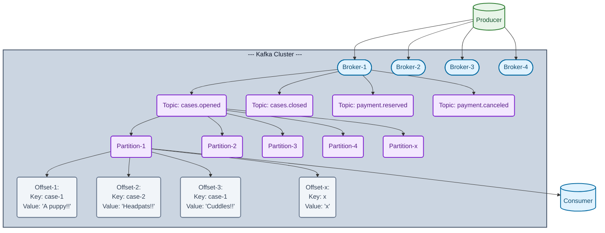

## Where I Noticed the Gap
* I noticed the gap while working on `yashiro-miko`. Originally, I thought about setting up a simple gRPC service using Protobuf to serialize the payload and send it over. However, this introduced major bottlenecks: many gRPC connections ended up timing out instead of delivering what we expected. Because we don't need low-latency responses once the initial request completes—we just need guaranteed delivery to Python—gRPC was the wrong fit. Furthermore, gRPC shines when you have high, constant throughput; spinning it up for a rare edge case that only triggers 2% of the time on very unlucky days just feels inefficient.

## The Problem
* While gRPC is extremely fast, we didn't actually need that speed because we close the client connection as soon as we determine the verdict isn't `"ALLOW"`. Letting gRPC channels sit idle was risky when what we really needed was a "fire-and-forget" workflow: hand off the payload to Python and let it handle the remaining processing asynchronously. At first, the simplest fix seemed to be inserting the data into PostgreSQL before calling gRPC and using `river` as a background worker to retry failed deliveries. (We actually have to do that for Kafka too via the transactional outbox pattern, since broker connections can drop as well.)
* **The real issue is what happens after the data reaches the destination:** if Python receives the gRPC payload and crashes mid-process, you suffer immediate data loss. At that point, the fraud analyst throws their coffee cup against the wall and sues your company, your personality, your indecency, and your dog - which is definitely not daijoubu. The core solution is that Kafka persists messages. With auto-commit disabled, if the Python consumer crashes before finishing its work, Kafka sees that the offset was never committed and retains the message for reprocessing. With gRPC, replicating that durability would force you to build a whole custom state-tracking and background recovery pipeline from scratch.
### When to Use Each (Out of context explanation)
* **HTTP:** Use it for external-facing APIs, webhooks, or public service handlers where universal compatibility, human-readable debugging, and standard request/response semantics matter most.
* **gRPC:** Use it strictly for synchronous, internal inter-service (or cross-language) communication when the caller is actively waiting on an immediate answer, data lookup, or RPC execution before proceeding.
* **Kafka:** Use it for asynchronous, event-driven pipelines where you don't need an immediate synchronous response (after closing the client connection), and you need durable, decoupled, guaranteed at-least-once delivery—even if downstream consumers crash.

## Underlying Concept / How it Works (architecture)
* Lemme first explain how it all works - firstly, the main architecture, from biggest to smallest:
* * **Kafka Cluster** -> Don't be afraid of this term (because it reminds you of Kubernetes). This is purely a term to say "a group of Brokers" - there is no magical "Cluster that does a different job." Think of this term like "man" and "men": one simply means singular, while the other means plural.
* * **Broker** -> Think of a broker as a VM (not exactly, but it helps the mental model). That's where the data you send as a producer goes. For example, later we can use Kubernetes to scale the Brokers horizontally (or vertically), since their memory gets filled too. This is why I first talked about a "Cluster" - to make you understand that Brokers can run out of memory, since one might contain too many "Topics."
* * **Topic** -> This is the interesting part: the topic is what contains all the stuff we send. When we specify where to send data, we MUST specify the Topic name. Think of it as a folder inside the Broker - a Broker can have multiple "folders" (topics); for example, it might have `cases.opened`, `cases.closed`, `user.pending`, and many more. A Topic consists of partitions.
* * **Partitions** -> This is optional, but strongly suggested for better readability. Here we organize a "set" of things - for example, it's not like a Topic will contain random, sprawled data everywhere, nuh-uh, it will store it in a partition. You CANNOT name a partition; each partition acts as storage for "Records."
* * **Records** -> Each partition is filled with different records - a record is composed of a Key (we can specify the name, for example: "case-1") and a Value (the actual data turned into bytes; for example, we give it data with Protobuf).
* * **Offset** -> Each Record have a Key and a Value, but we can reuse the same Key multiple times, since Kafka is an append-only, it won't overwrite the older record with the new data, instead it will simply create a new offset (think of an offset as an index). As example, if we use the strategy of naming a Key something as "`case.<tenantID>.<payerHashedIban>.<payeeHashedIban>`" - the moment the same person retries it, it will not overwrite the last Record, it will simply create a new offset (as for everyone), and append it there.
* * **Full overview (for example)** -> We send data to a Topic named "cases.opened" - it will first enter a broker and reach the topic named "cases.opened". Inside that topic, it will look for a free partition; once it finds one, it goes inside, looks at everything it has ("case-1", "case-2", etc.), and enters the free one, leaving its data inside.
* **Producer/Consumer:**
* * **Producer** -> The one inserting data inside a Topic (`yaotose`, `miko`)
* * **Consumer** -> The one polling data from a Topic (`miko`, `azami`)

## Workflow / Lifecycle (Diagram)


## Example Code and Explanation
* **Inside `main.go`:**
```go
kafkaClient, err := kgo.NewClient( kgo.SeedBrokers(kafkaAddr) )
```
* * Like Redis or HTTP, it expects a client. We can easily create one using the idiomatic library [github.com/twmb/franz-go/pkg/kgo](https://github.com/twmb/franz-go/tree/master/pkg/kgo), where we simply need to specify where Kafka is listening.
* **Inside `handler.go`:**
```go
record := &kgo.Record{
    Topic: "cases.opened",
    Key:   []byte(caseForm),
    Value: payload,
}

err := y.Kafka.ProduceSync(kafkaTimeout, record).FirstErr()
```
* * This is the easiest part. All we do here is send the record to a specified destination - in our case, a Topic named "cases.opened" (which routes it to a broker). Next, we specify the Key (the record's identifier), and finally, the payload—the record's Value.